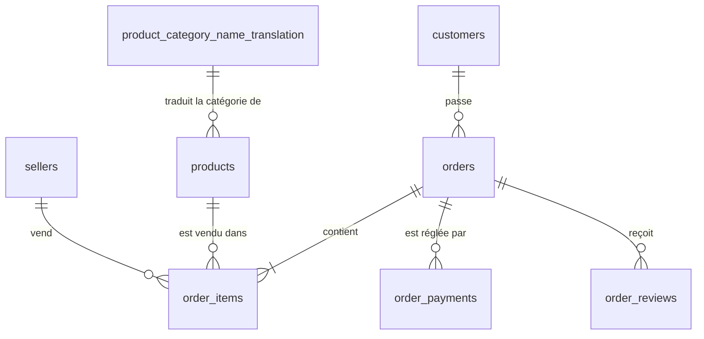

# Analyse e-commerce Olist : projet SQL (PostgreSQL)

Construire de bout en bout une base de données relationnelle PostgreSQL à partir du dataset public **Olist** (e-commerce brésilien), la nettoyer, puis l'analyser en SQL.

> 🚧 **Projet en cours.** Ce dépôt est mis à jour au fur et à mesure de l'avancement.

## Avancement

- [x] Création du schéma relationnel (9 tables, clés primaires et étrangères)
- [x] Import des données
- [ ] Nettoyage des données (`customers` terminée, `sellers` en cours, autres tables à venir)
- [ ] Analyses SQL
- [ ] Visualisation dans Power BI

## Le dataset

Dataset public d'environ 100 000 commandes passées sur la marketplace brésilienne Olist entre 2016 et 2018. Il se compose de 9 fichiers CSV : clients, vendeurs, produits, commandes, articles commandés, paiements, avis, géolocalisation et traduction des catégories de produits.

## Outils

- PostgreSQL 18
- pgAdmin 4
- Power BI (prévu pour la restitution)

## Schéma de la base

La table `geolocation` n'a aucune clé étrangère : elle sert de référentiel de coordonnées par préfixe de code postal.

## Choix de conception

- **Ordre de création** : les tables sont créées selon leurs dépendances (tables indépendantes d'abord, puis celles qui les référencent).
- **Codes postaux en `VARCHAR`** : on ne fait aucun calcul dessus, et un entier ferait disparaître silencieusement les zéros en début de code (`01310` deviendrait `1310`).
- **`customer_id` et `customer_unique_id`** : `customer_id` est propre à chaque commande, alors que `customer_unique_id` identifie le client réel et se répète. C'est donc `customer_id` qui est la clé primaire de `customers`.
- **Clés primaires composites** : `order_items` (`order_id`, `order_item_id`), `order_payments` (`order_id`, `payment_sequential`) et `order_reviews` (`review_id`, `order_id`), car aucune de ces colonnes n'est unique seule.
- **`geolocation`** : clé primaire artificielle (`SERIAL`), car le préfixe de code postal se répète.
- **`NOT NULL`** : posé uniquement après avoir constaté dans les données que la colonne est toujours remplie, et non sur un simple raisonnement théorique.

## Qualité des données : problèmes rencontrés

| Table | Problème | Démarche |
|---|---|---|
| `products` | 2 catégories absentes de la table de traduction (`pc_gamer`, `portateis_cozinha_e_preparadores_de_alimentos`), ce qui bloquait la clé étrangère à l'import | Contrainte retirée temporairement, import, détection des valeurs orphelines (`NOT IN`), ajout des 2 catégories, contrainte rétablie |
| `sellers` | Valeurs parasites dans `seller_city` : état collé à la ville (`ville/sp`), code numérique, adresse e-mail, district entre parenthèses | Colonne `seller_city_clean` ajoutée, l'originale restant intacte. Corrections par expression régulière, puis cas particuliers déduits du code postal |
| `sellers` | Mêmes codes postaux associés à plusieurs orthographes de ville | Règle de l'orthographe majoritaire par code postal (fonction de fenêtrage), exceptions traitées à la main |

**Principe retenu** : le code postal fait foi pour la ville. Un nom d'état saisi à la place de la ville est remplacé par la commune correspondante, et un district par sa commune.

## Structure du dépôt

- `01_creation.sql` : création des 9 tables

Les autres scripts (nettoyage, analyses) seront ajoutés au fur et à mesure.

## Prochaines étapes

1. Terminer le nettoyage des tables restantes
2. Écrire les requêtes d'analyse (chiffre d'affaires, délais de livraison, satisfaction clients, performance des vendeurs)
3. Connecter la base à Power BI pour la restitution visuelle
